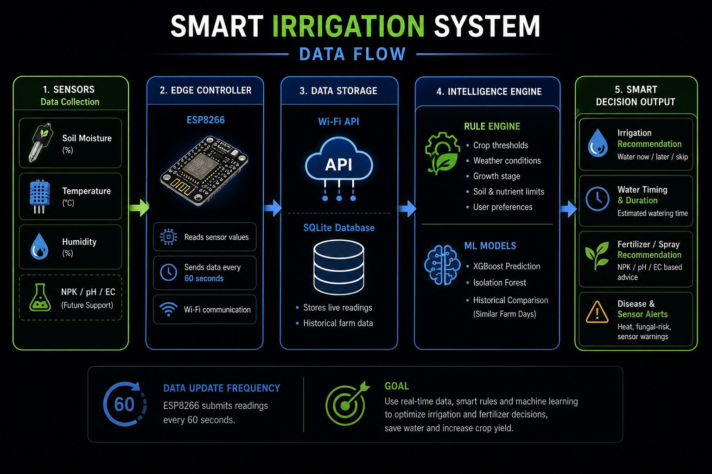

# 🌱 PlantPulse

A smart-irrigation monitoring system. An **ESP8266** reads soil moisture, temperature and
humidity and sends the readings over Wi-Fi to a **FastAPI** server, which stores them in
**SQLite**, runs crop rules and **machine-learning models** over the history, and serves a
live dashboard with watering and fertiliser recommendations.



## How it works

1. **Sensors** — soil moisture (analog), temperature and humidity (DHT11).
2. **Edge controller** — an ESP8266 reads the sensors and POSTs a reading to the server
   every 60 seconds. Wi-Fi and server details are entered once through a setup hotspot
   and stored in the board's EEPROM.
3. **Storage** — the FastAPI server keeps live readings and history in SQLite.
4. **Intelligence engine** — crop threshold rules combined with ML models trained on the
   farm's own history.
5. **Output** — watering recommendations, timing, fertiliser advice and disease/sensor
   alerts on the dashboard.

## Features

- Live dashboard with moisture, temperature and humidity history
- 16 crop profiles (plus a custom one) with dry/wet thresholds, temperature and humidity
  ranges, and growth-stage adjustments (seedling → fruiting)
- Watering and fertiliser recommendations, and a generated pump plan
- ML models (XGBoost + Isolation Forest) for:
  - will the soil cross the dry threshold in the next 24 h
  - how much moisture will be lost, converted to a water amount
  - fungal-risk humidity streaks within 48 h
  - anomaly detection on recent sensor readings
- AI chat assistant (Groq or Gemini) with saved conversation threads
- Backtesting and feedback on AI watering decisions
- Multi-device support, CSV export, anomaly list
- Accounts with salted PBKDF2-HMAC-SHA256 password hashing
- Open to other devices on the same Wi-Fi (LAN access)

## Tech stack

| Layer | Technology |
|---|---|
| Firmware | Arduino C++ on ESP8266 (NodeMCU), DHT11, ArduinoJson |
| Backend | Python, FastAPI, Uvicorn |
| Database | SQLite |
| ML | XGBoost, scikit-learn (Isolation Forest), joblib |
| Frontend | Single-page HTML/CSS/JavaScript served by the backend |
| AI chat | Groq or Gemini via their OpenAI-compatible APIs |
| Weather | Open-Meteo (free, no key) |

## Hardware

- NodeMCU ESP8266 (ESP-12E)
- DHT11 temperature/humidity sensor (pin D4)
- Analog soil-moisture sensor (pin A0)

> The included sketch only **reads sensors and reports them**. The pump and fertiliser-spray
> endpoints in the server track state, plans and a watering log in software; the sketch does
> not drive a relay.

## Getting started

### 1. Run the server

On Windows, `start.bat` creates the virtual environment, installs the dependencies and
starts the server:

```
.\start.bat
```

Or manually:

```
python -m venv venv
venv\Scripts\activate
pip install -r requirements.txt
python main.py
```

The dashboard opens at <http://localhost:8000>.

### 2. Try it without hardware

Load a year of realistic demo data (uses real historical weather from Open-Meteo for the
location set in Settings, then simulates soil moisture on top of it):

```
python seed_demo_data.py
```

Then open the dashboard and train the models from there (it calls `POST /api/ml/train`)
to build the ML models from that history.

### 3. Connect a real ESP8266

1. Open `plantpulse_esp8266/plantpulse_esp8266.ino` in the Arduino IDE
   (board: *NodeMCU 1.0 (ESP-12E Module)*) and upload it.
2. Find your computer's IP with `ipconfig`.
3. Press RST on the board, join its **PlantPulse-Setup** hotspot, open
   <http://192.168.4.1>, then enter your Wi-Fi name, password and your computer's IP.
4. Reconnect your phone/laptop to your normal Wi-Fi.

The setup hotspot uses a fixed default password set in the sketch — change it there before
deploying anywhere other than your own desk.

### 4. Open it from another device

Run `setup-lan.bat` once (it asks for Administrator rights to add a firewall rule limited
to the local subnet and TCP port 8000), then start the server and use the **Local
network** URL it prints.

## Configuration

Copy `.env.example` to `.env` and fill in what you need. Nothing is required to run the
dashboard; the keys below only enable the AI chat and AI decisions.

| Variable | Purpose |
|---|---|
| `GROQ_API_KEY` | Enables AI chat via Groq |
| `GROQ_MODEL` | Groq model name (optional) |
| `GEMINI_API_KEY` | Enables AI via Gemini |
| `GEMINI_MODEL` | Gemini model name (optional) |
| `AI_MAX_TOKENS` | Cap on AI reply length (default 450) |
| `PLANTPULSE_DEV` | Set to `1` for auto-reload while developing |

`.env`, the SQLite database and the trained models are deliberately not in the repository.

## Project layout

```
main.py                 FastAPI app: API, rules, AI chat, serves the dashboard
ml_engine.py            XGBoost / Isolation Forest training and prediction
index.html              Dashboard frontend
seed_demo_data.py       Generates a year of demo data
knowledge/              Crop care notes used to ground the AI assistant
plantpulse_esp8266/     ESP8266 firmware sketch
start.bat / start.ps1   Windows launchers
setup-lan.bat           One-off firewall rule for LAN access
docs/                   Diagrams
```
